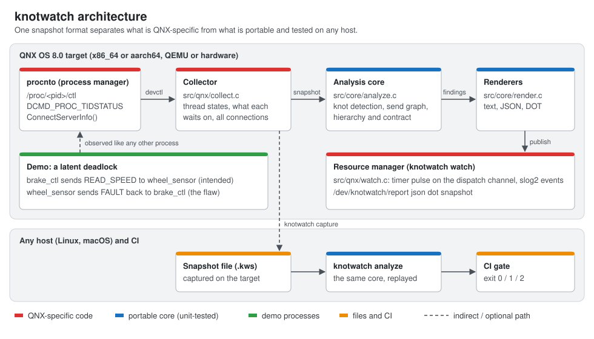
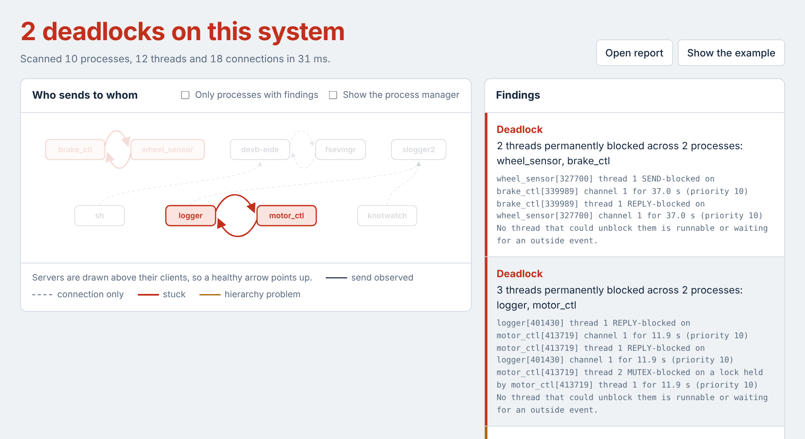

# knotwatch

Finds message-passing deadlocks on QNX OS 8.0, including the ones that have
not happened yet.

QNX systems are built from processes that talk by synchronous message passing.
The classic rule for keeping that deadlock-free is the *send hierarchy*: never
have two threads send to each other, and keep all sends going one way up a
tree. Nothing enforces the rule. A violation usually sits unnoticed until a
rare code path sends a message "the wrong way", and then two processes wait on
each other forever.

knotwatch watches a running system and reports three things:

| Finding | Meaning | Severity |
| --- | --- | --- |
| `deadlock` | A set of threads that no runnable thread can ever unblock | critical |
| `blocking-cycle` | Processes blocked on each other right now, not yet provably permanent | critical |
| `mutual-send` | Sends have been observed around a cycle: the hierarchy is violated | warning |
| `contract` | A send or connection breaks the layering you declared | warning |
| `potential-cycle` | Connections form a cycle, though no message has crossed it yet | notice |

The last one is the point: the demo system is flagged while it is still
running normally, minutes before it deadlocks.

```
[CRITICAL] deadlock: 2 threads permanently blocked across 2 processes: wheel_sensor, brake_ctl
  wheel_sensor[327700] thread 1 SEND-blocked on brake_ctl[339989] channel 1 for 21.0 s (priority 10)
  brake_ctl[339989] thread 1 REPLY-blocked on wheel_sensor[327700] channel 1 for 21.0 s (priority 10)
  No thread that could unblock them is runnable or waiting for an outside event.
```

That is real output from the demo on QNX OS 8.0 in QEMU. Twenty-five seconds
earlier, while both processes were still exchanging messages normally, the
same run had already reported:

```
[WARNING] contract: wheel_sensor (layer 1) holds a connection to brake_ctl (layer 2)
[NOTICE] potential-cycle: connections form a cycle, a latent deadlock if messages are sent around it: wheel_sensor -> brake_ctl -> wheel_sensor
```

## Status

- Builds with QNX SDP 8.0 (`ntox86_64-gcc`) without warnings and runs on QNX
  OS 8.0.0, x86_64, in QEMU. The demo scenario passes end to end:
  `scripts/qnx-image.sh` then `scripts/qemu-run.sh`.
- The portable core (snapshot format, analysis, contract, renderers, CLI) is
  tested on Linux with `make check`, also clean under ASan and UBSan.
- Not yet run on aarch64 or on hardware.
  [docs/VERIFICATION.md](docs/VERIFICATION.md) lists what has been confirmed
  on a target and what has not.

## How it works



A scan reads, for every process, each thread's kernel state and what it is
blocked on (`DCMD_PROC_TIDSTATUS` on `/proc/<pid>/ctl`) and every connection
the process holds (`ConnectServerInfo()`). For a thread blocked on a mutex it
also reads the mutex from that process's memory to learn which thread holds
it. That becomes a *snapshot*.

**Deadlock detection.** A client blocked on a server can be released by *any*
thread of that server, so a plain cycle search is not enough. knotwatch
computes which blocked threads still have a possible rescuer: a thread is
alive if it is runnable, waiting for an outside event, or has a kernel timeout
armed; a blocked thread is alive if anything it waits on is alive. Whatever is
left after that reaches a fixed point is a knot, and is reported as a
deadlock. Message waits, mutex waits and thread joins are all followed, so a
lock held across a send is caught too:

```
[CRITICAL] deadlock: 3 threads permanently blocked across 2 processes: logger, motor_ctl
  logger[401430] thread 1 REPLY-blocked on motor_ctl[413719] channel 1 for 11.9 s (priority 10)
  motor_ctl[413719] thread 1 REPLY-blocked on logger[401430] channel 1 for 11.9 s (priority 10)
  motor_ctl[413719] thread 2 MUTEX-blocked on a lock held by motor_ctl[413719] thread 1 for 11.9 s (priority 10)
```
 Only threads blocked for longer than the scan took are considered,
so everything reported was blocked at one common instant.

**Send graph.** Across scans knotwatch accumulates who has been seen sending
to whom, and who holds a connection to whom. Cycles in that graph are
hierarchy violations, split by evidence into `mutual-send` and
`potential-cycle`.

**Contract.** Optionally declare the hierarchy you intend and have it checked:

```
layer 0 procnto*
layer 1 wheel_sensor
layer 2 brake_ctl
ignore  hmi_* logger     # a link you have reviewed and accept
strict                   # every process must have a layer
```

A process may only send to a strictly lower layer.

## Build and run

Requirements: QNX SDP 8.0 (free through QNX Everywhere), GNU make. Tested
target: QNX OS 8.0.0 on x86_64 in QEMU, built with `ntox86_64-gcc` from the
SDP's Linux host tools. aarch64le builds the same way but is untested.

```sh
# On the target (self-hosted QNX Developer Desktop):
make

# Cross-compiling, with the QNX SDP 8.0 environment sourced:
make QNX=1 CC=ntox86_64-gcc  BUILD=build/x86_64      # QEMU x86_64
make QNX=1 CC=ntoaarch64-gcc BUILD=build/aarch64le   # Raspberry Pi, QEMU virt
```

From macOS, where the SDP tools do not run natively, the scripts below run
them in a small Linux container (Docker) and boot the result in QEMU
(`brew install qemu`). They expect the SDP in `~/qnx800` with the package
"QNX SDP Host Tools (Linux 64-bit)" installed.

```sh
sh scripts/qnx-docker-build.sh   # compile -> build/x86_64
sh scripts/qnx-image.sh          # bootable image with knotwatch and the demo
sh scripts/qemu-run.sh           # boot it, run the demo, print the reports
sh scripts/qemu-run.sh console   # or get an interactive console instead
```

On the target, as root:

```sh
knotwatch scan                       # one scan, report, exit code for scripts
knotwatch scan --contract my.contract
knotwatch watch &                    # resource manager
cat /dev/knotwatch/report            # live findings
cat /dev/knotwatch/dot | dot -Tsvg > sendgraph.svg
knotwatch capture > system.kws       # take a snapshot home
```

The demo:

```sh
knotwatch watch --contract demo/demo.contract &
wheel_sensor --fault-after 300 &     # faults after about 30 s
brake_ctl &
cat /dev/knotwatch/report            # now: potential-cycle and contract warning
sleep 40; cat /dev/knotwatch/report  # after the fault: deadlock
```

On any host (Linux, macOS), no QNX tools needed:

```sh
make && make check
build/knotwatch analyze system.kws --format json
```

Exit status: 0 clean or notices only, 1 warnings, 2 deadlock or blocking
cycle. That makes `knotwatch scan` usable as a gate in a QEMU-based CI job.

## Report viewer

`viewer/index.html` is a single self-contained page that draws a JSON report:
the send graph with servers above their clients, and the findings beside it.
Selecting a finding highlights the processes involved. Open the file in a
browser, then drop a report on it or choose "Show the example".



```sh
knotwatch scan --format json > report.json        # on the target
build/knotwatch analyze system.kws --format json  # or from a snapshot, on any host
```

The page is generated from `viewer/template.html` by `scripts/make-viewer.sh`,
which embeds a real report of `viewer/example.kws` as the example.

## Where QNX is used

| What | Where |
| --- | --- |
| Thread states and block reasons from the process manager | `src/qnx/collect.c`, `collect_threads()` |
| Connection enumeration with `ConnectServerInfo()` | `src/qnx/collect.c`, `collect_connections()` |
| Mutex owner read from the waiter's address space (`/proc/<pid>/as`) | `src/qnx/collect.c`, `resolve_lock_owners()` |
| Resource manager with per-open pinned contents (extended OCB) | `src/qnx/watch.c`, `io_read()`, `ocb_calloc()` |
| Timer pulse on the dispatch channel | `src/qnx/watch.c`, `kw_watch_run()`, `on_tick()` |
| slog2 event logging | `src/qnx/watch.c`, `log_changes()` |
| Native message passing, `name_attach()`/`name_open()` | `demo/brake_ctl.c`, `demo/wheel_sensor.c` |
| A mutex held across `MsgSend()` | `demo/motor_ctl.c`, `demo/logger.c` |

## Limits

- knotwatch is a development, integration and CI tool. QNX documents `/proc`
  as a debugging interface and advises against using it to monitor production
  systems; knotwatch follows that advice.
- Condition-variable, semaphore and read-write-lock waits are not followed. A
  thread blocked on one is treated as alive, so such deadlocks are missed,
  never misreported.
- The owner of a mutex is decoded from the value QNX stores in it. That
  encoding was established by observation on QNX OS 8.0.0 x86_64 and agrees
  with `pidin`; it is not a documented interface. When the owner cannot be
  determined with certainty the waiter is treated as alive, and the report
  says so.
- A `potential-cycle` is a hint. Two processes may hold connections to each
  other and only ever exchange pulses, which cannot deadlock. Review it, then
  `ignore` it in the contract.
- Processes are identified by executable name in the send graph, so several
  instances of one program are one node.
- Edges that start at the process manager (`procnto`) are left out of the
  hierarchy and contract checks. It is the microkernel, and it and the
  drivers hold connections to each other by design.

## License

MIT, see [LICENSE](LICENSE).
